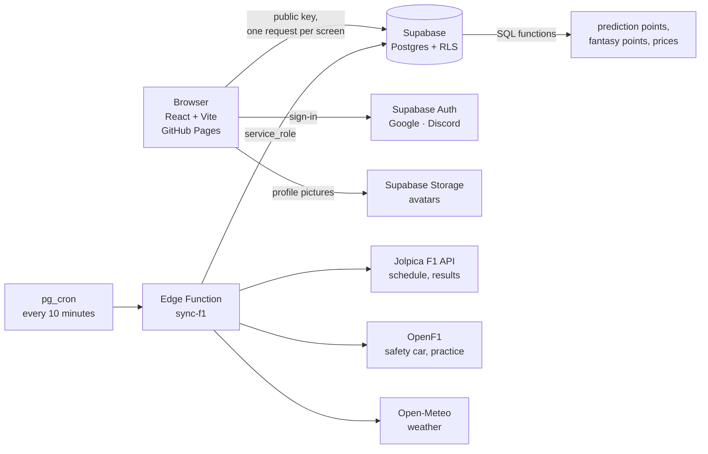

<div align="center">

# Gridline

**Formula 1 predictions and fantasy league for friends**

[](https://github.com/pufixluv1984-bit/gridline-v2/actions/workflows/ci.yml)
[](https://github.com/pufixluv1984-bit/gridline-v2/actions/workflows/deploy.yml)
[](https://github.com/pufixluv1984-bit/gridline-v2/actions/workflows/keepalive.yml)
[](https://github.com/pufixluv1984-bit/gridline-v2/actions/workflows/backup.yml)

**[Open the website →](https://pufixluv1984-bit.github.io/gridline-v2/)**


</div>

---

Gridline is an unofficial, non-commercial website where a group of friends plays two games around every Formula 1 race weekend:

1. **Predictions.** Before the session starts, predict the qualifying top 3, the race top 10 and bonus picks (fastest lap, first retirement, safety car). After the race the points are scored automatically and the league table updates.
2. **Fantasy league.** Pick 5 drivers and 2 constructors within a $100M budget. Prices are live: after every race they adjust to each driver's form on their own. Transfers, a DRS multiplier and chips included. The rules are our own, not a copy of the official F1 Fantasy.

Leagues can have any number of players: create a lobby and invite friends with a link or a code. Sign-in is via Google or Discord.

> The website is available in **English, Ukrainian and Russian**: pick a language on the sign-in screen or in settings.

## Screenshots

<table>
  <tr>
    <td></td>
    <td></td>
  </tr>
  <tr>
    <td align="center">Driver catalogue</td>
    <td align="center">Driver profile</td>
  </tr>
  <tr>
    <td></td>
    <td></td>
  </tr>
  <tr>
    <td align="center">Season circuits</td>
    <td align="center">Fantasy rules</td>
  </tr>
</table>

## Features

**Predictions game**
- One prediction per race weekend, shared across all of a player's leagues; leagues differ only in which bonuses are enabled.
- Per-block deadlines (from the 2026 Qatar GP): qualifying closes when qualifying starts, the sprint when the sprint starts, the race and bonuses when the race starts. You make your race prediction already knowing the grid.
- ×2 booster (one per 5-race window) and bonus picks: fastest lap, first retirement, safety car.
- Other players' picks stay hidden until the deadline — enforced by the database, not the UI.
- Line-by-line points breakdown, league table with position changes and 5-race form, season titles ("Sniper", "Best race", "Survivor").

**Fantasy league**
- 5 drivers + 2 constructors, $100M budget, free transfers (bank up to two), −10 for each extra one.
- DRS ×2 and six chips: Wildcard, Limitless, Final Fix, Autopilot, No Negative, Extra DRS.
- **Live prices:** a form rating (recent points, season average, qualifying and head-to-head vs teammate, trend) → a fair price → the price moves 30% of the way towards it, capped at ±0.8 per race. [Formula →](docs/FANTASY-FORMULA.md#4-цены)
- Market with a price chart and the reason for each change, leaderboard, race results, analytics.
- If a driver doesn't race, their team's reserve driver is substituted automatically.

**Everything else**
- Calendar with countdowns and weather, results (including practice sessions), circuit maps, driver catalogue with careers and Wikipedia biographies in each language.
- **Three languages** (English, Ukrainian, Russian). The choice is saved in the profile and follows the player across devices.
- Profile picture (JPG, PNG, WebP or animated GIF, cropped in the browser) or a letter avatar.
- Automatic season rollover: leagues carry over, starting prices come from last season's championship.
- Smooth scaling for large screens, from 1440 to 4K and ultrawide monitors.

## How it works



- **The browser never calls external F1 APIs.** The data is the same for everyone, so the `sync-f1` server function fetches it once and stores it in the database.
- **The database does the scoring.** SQL functions are idempotent: re-running them never duplicates anything. The UI only displays ready-made rows.
- **Security lives in the database.** Deadlines, hidden picks, the fantasy budget and league roles are enforced by Row Level Security policies and triggers. The browser only has the public key.
- **Server time.** Countdowns and open/closed states use `server_now()`, not the device clock.
- **Three languages without a library.** Interface text lives in typed per-language dictionaries, each loaded on demand. Names and messages the database stores in Russian (Grand Prix, teams, drivers, errors, price reasons) are translated in the Supabase client as responses arrive, so the SQL stays untouched. Tests fail if a string bypasses the dictionaries or a new name has no translation.

More detail (in Russian): [architecture](docs/ARCHITECTURE.md) · [game mechanics](docs/PRODUCT.md) · [fantasy formula](docs/FANTASY-FORMULA.md) · [design](docs/DESIGN.md).

## Tech stack

| Layer | What's used |
|---|---|
| Frontend | React 19, TypeScript (strict), Vite, TanStack Query, React Router (`HashRouter`), CSS Modules + CSS custom properties, own i18n (uk · ru · en) |
| Backend | Supabase: Postgres, Row Level Security, Auth (Google, Discord), Storage, Edge Functions (Deno), `pg_cron` + `pg_net` |
| F1 data | [Jolpica F1 API](https://github.com/jolpica/jolpica-f1), [OpenF1](https://openf1.org), [Open-Meteo](https://open-meteo.com) |
| Tests | Vitest + Testing Library (frontend), pgTAP (`supabase test db`: RLS, scoring, prices) |
| Infrastructure | GitHub Pages, GitHub Actions (CI, deploy, daily keep-alive, nightly encrypted database backup) |

## Quality

- **91** unit tests and **18** pgTAP database test suites run in CI on every push.
- **24** migrations: the schema changes only through files in `supabase/migrations/`, never by hand in the console.
- Initial JS is **≈159 KB** gzipped against a 250 KB budget (checked in CI). Screens load on demand; fonts are self-hosted, no Google Fonts.
- WCAG AA accessibility on every screen (checked with axe).

## Repository layout

```
src/
  app/          router, shared layout
  features/     screens: home, predict, league, fantasy, drivers, schedule, results, profile, settings, lobby…
  i18n/         dictionaries (uk, ru, en), translation of database texts
  lib/          API modules (src/lib/api/*), time, UI scaling, avatars, assets
  ui/           shared components: sidebar, dialogs, avatar, toasts, cards
  styles/       design tokens and shared styles
supabase/
  migrations/   schema, RLS policies, SQL scoring and pricing functions
  functions/    sync-f1 — scheduled sync with F1 data APIs
  tests/        pgTAP
docs/           product, architecture, fantasy formula, design, decisions
```

## Project timeline

| When | What was built |
|---|---|
| 11 Nov 2026 | **Phase 0.** Scaffold, Google and Discord sign-in, deployment, CI |
| 11–12 Nov | **Phase 1.** Predictions game: leagues, predictions, countdowns, automatic results, scoring, league table |
| 12 Nov | **Phase 2.** Bonuses, ×2 booster, race breakdown, practice sessions |
| 12 Nov | **Phase 3.** Player profile, season titles, league table, driver catalogue |
| 12 Nov | **Phase 4.** Fantasy: squads, scoring, prices, market, leaderboard, analytics |
| 12 Nov | **Phase 5.** Per-block deadlines and sprints, season rollover, dialogs and error states, accessibility |
| 12 Nov | Polish: frameless layout, sidebar, profile photos and GIFs, large screens, settings page, keep-alive, **live fantasy prices** |
| 12 Nov | **Languages:** the whole site in English, Ukrainian and Russian, including database texts, driver biographies and the privacy policy |

Every decision and the reasoning behind it is in the [decision log](docs/DECISIONS.md); changes by date are in the [CHANGELOG](CHANGELOG.md).

## Rights

The code is published **for viewing only**: copying, modifying or running it yourself without the author's permission is not allowed — see [LICENSE](LICENSE). Anyone is welcome to use the [website](https://pufixluv1984-bit.github.io/gridline-v2/) itself: come and play with your friends.

## Disclaimer

This is an unofficial, non-commercial fan project. It is not associated with Formula One Group, the FIA or any team. Formula 1, F1 and related marks are trademarks of Formula One Licensing B.V. Driver and car photos and team logos belong to their respective owners and are used for illustration only.

## Author

**pufixluv** · [Telegram](https://t.me/pufixluv) · [X](https://x.com/pufixluv)
