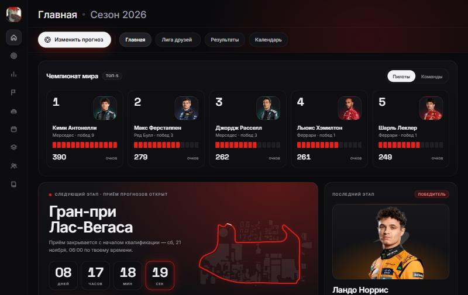
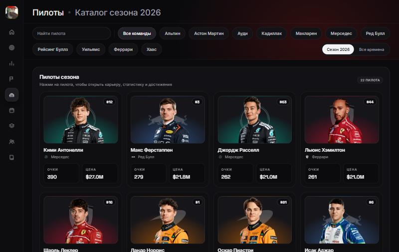
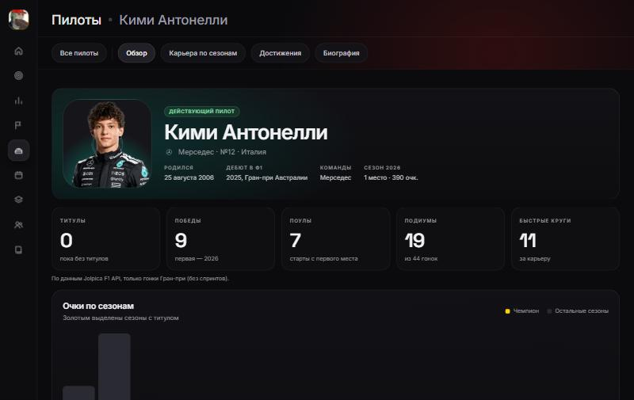
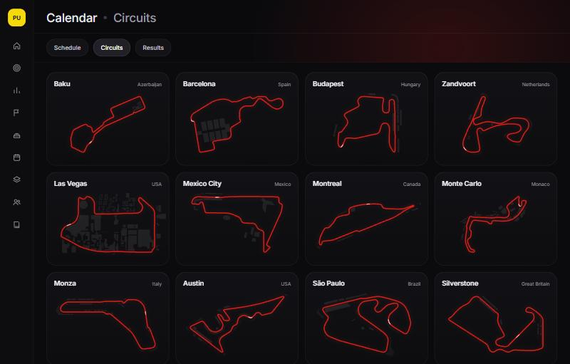
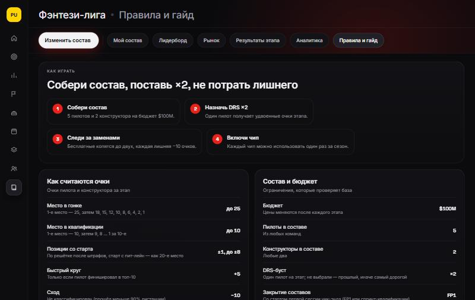
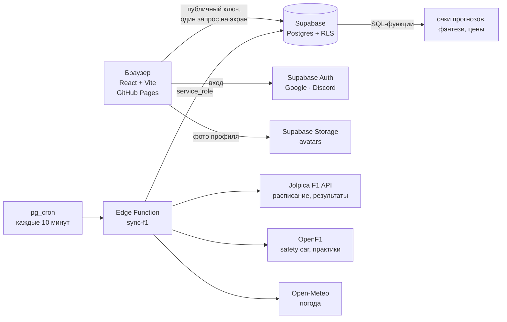

<div align="center">

# Gridline

**Прогнозы и фэнтези-лига по Формуле-1 для друзей**

[](https://github.com/pufixluv1984-bit/gridline-v2/actions/workflows/ci.yml)
[](https://github.com/pufixluv1984-bit/gridline-v2/actions/workflows/deploy.yml)
[](https://github.com/pufixluv1984-bit/gridline-v2/actions/workflows/keepalive.yml)
[](https://github.com/pufixluv1984-bit/gridline-v2/actions/workflows/backup.yml)

**[Открыть сайт →](https://pufixluv1984-bit.github.io/gridline-v2/)**



</div>

---

Gridline — неофициальный некоммерческий сайт, на котором компания друзей играет в две игры по каждому этапу Формулы-1:

1. **Прогнозы.** До квалификации угадываешь топ-3 квалификации, топ-10 гонки и бонусы (быстрый круг, первый сход, safety car). После гонки очки считаются сами, таблица лиги обновляется.
2. **Фэнтези-лига.** Собираешь состав из 5 пилотов и 2 конструкторов на бюджет $100M. Цены живые: после каждого этапа они сами подстраиваются под форму пилота. Есть трансферы, DRS-множитель и чипы. Правила свои, а не копия официальной F1 Fantasy.

Лиги на любое число игроков: создаёшь лобби, зовёшь друзей ссылкой или кодом. Вход — через Google или Discord.

## Скриншоты

<table>
  <tr>
    <td></td>
    <td></td>
  </tr>
  <tr>
    <td align="center">Каталог пилотов</td>
    <td align="center">Профиль пилота</td>
  </tr>
  <tr>
    <td></td>
    <td></td>
  </tr>
  <tr>
    <td align="center">Трассы сезона</td>
    <td align="center">Правила фэнтези</td>
  </tr>
</table>

## Возможности

**Игра прогнозов**
- Прогноз один на этап и общий для всех лиг игрока; лиги отличаются набором включённых бонусов.
- Дедлайн по блокам (с Гран-при Катара 2026): квалификация закрывается со стартом квалификации, спринт — со стартом спринта, гонка и бонусы — со стартом гонки. Прогноз на гонку делаешь, уже зная квалификацию.
- Бустер ×2 (один на окно из 5 этапов), бонусы «быстрый круг», «первый сход», «safety car».
- Чужие прогнозы не видны до дедлайна — это обеспечивает база, а не интерфейс.
- Разбор очков по каждой строке, таблица лиги со сдвигом мест и формой за 5 этапов, звания сезона («Снайпер», «Лучший этап», «Выживший»).

**Фэнтези-лига**
- Состав 5 + 2, бюджет $100M, бесплатные трансферы (копятся до двух), штраф −10 за лишний.
- DRS ×2 и шесть чипов: Wildcard, Limitless, Final Fix, Autopilot, No Negative, Extra DRS.
- **Живые цены:** рейтинг формы (свежие очки, сезон, квалификация и сравнение с напарником, тренд) → справедливая цена → цена проходит 30% пути к ней, не больше ±0.8 за этап. [Формула →](docs/FANTASY-FORMULA.md#4-цены)
- Рынок с графиком цены и причиной изменения, лидерборд, результаты этапа, аналитика.
- Пилот не едет — резервист его команды подставляется автоматически.

**Остальное**
- Календарь с таймером и погодой, результаты (включая практики), схемы трасс, каталог пилотов с карьерой и биографией.
- Профиль с фото (JPG, PNG, WebP или анимированный GIF, кадрирование в браузере) или аватаром из букв.
- Автопереход на новый сезон: лиги переносятся, стартовые цены считаются из итогов прошлого чемпионата.
- Плавное масштабирование под большие экраны: от 1440 до 4K и ультрашироких мониторов.

## Как это устроено



- **Браузер никогда не ходит во внешние F1-API.** Данные общие для всех, поэтому их один раз забирает серверная функция `sync-f1` и кладёт в базу.
- **Очки считает база.** SQL-функции идемпотентны: повторный запуск ничего не дублирует. Интерфейс только показывает готовые строки.
- **Безопасность — на стороне базы.** Дедлайны, чужие прогнозы, бюджет фэнтези, роли в лиге проверяют RLS-политики и триггеры. В браузере есть только публичный ключ.
- **Время — серверное.** Таймеры и «закрыто/открыто» считаются от `server_now()`, а не от часов устройства.

Подробно: [архитектура](docs/ARCHITECTURE.md) · [механика игры](docs/PRODUCT.md) · [формула фэнтези](docs/FANTASY-FORMULA.md) · [дизайн](docs/DESIGN.md).

## Стек

| Слой | Что используется |
|---|---|
| Фронтенд | React 19, TypeScript (strict), Vite, TanStack Query, React Router (`HashRouter`), CSS Modules + CSS-переменные |
| Бэкенд | Supabase: Postgres, Row Level Security, Auth (Google, Discord), Storage, Edge Functions (Deno), `pg_cron` + `pg_net` |
| Данные F1 | [Jolpica F1 API](https://github.com/jolpica/jolpica-f1), [OpenF1](https://openf1.org), [Open-Meteo](https://open-meteo.com) |
| Тесты | Vitest + Testing Library (фронт), pgTAP (`supabase test db`: RLS, очки, цены) |
| Инфраструктура | GitHub Pages, GitHub Actions (CI, деплой, ежедневный keep-alive, ночной зашифрованный бэкап базы) |

## Качество

- **74** unit-теста и **16** наборов pgTAP-тестов базы гоняются в CI на каждый push.
- **22** миграции: схема меняется только файлами в `supabase/migrations/`, никаких правок «руками в консоли».
- Стартовый JS **≈159 КБ** gzip при бюджете 250 КБ (проверка в CI). Экраны грузятся по требованию, шрифты свои, без Google Fonts.
- Доступность WCAG AA на всех экранах (проверено axe).

## Путь проекта

| Когда | Что сделано |
|---|---|
| 11 ноября 2026 | **Фаза 0.** Каркас, вход через Google и Discord, деплой, CI |
| 11–12 ноября | **Фаза 1.** Игра прогнозов: лиги, прогноз, таймеры, автоматические результаты, очки, таблица |
| 12 ноября | **Фаза 2.** Бонусы, бустер ×2, разбор этапа, практики |
| 12 ноября | **Фаза 3.** Профиль, звания, таблица лиги, каталог пилотов |
| 12 ноября | **Фаза 4.** Фэнтези: составы, очки, цены, рынок, лидерборд, аналитика |
| 12 ноября | **Фаза 5.** Дедлайны по блокам и спринты, автопереход сезона, окна и ошибки, доступность |
| 12 ноября | Полировка: лейаут без рамки, меню, фото и GIF профиля, большие экраны, страница настроек, keep-alive, **живые цены фэнтези** |

Все решения с причинами — в [журнале решений](docs/DECISIONS.md), изменения по датам — в [CHANGELOG](CHANGELOG.md).

## Запуск локально

Нужны Node.js 24, pnpm и (для своей базы) Docker с [Supabase CLI](https://supabase.com/docs/guides/cli).

```bash
pnpm install
cp .env.example .env.local   # адрес проекта Supabase и публичный (anon) ключ
pnpm dev                     # http://localhost:5173
```

Без `.env.local` сайт открывается в режиме каркаса: экраны видны, данных нет.

```bash
pnpm typecheck && pnpm lint && pnpm test   # проверки фронта
pnpm build                                 # сборка в dist/
supabase start && supabase db reset        # локальная база с миграциями и seed
supabase test db                           # тесты базы (pgTAP)
```

Что настраивается вручную (проект Supabase, OAuth, секреты GitHub) — в [чек-листе](docs/SETUP-CHECKLIST.md).

## Структура

```
src/
  app/          роутер, общий лейаут
  features/     экраны: home, predict, league, fantasy, drivers, schedule, results, profile, settings, lobby…
  lib/          API-модули (src/lib/api/*), время, масштаб, аватар, ассеты
  ui/           общие компоненты: меню, окна, аватар, тосты, карточки
  styles/       токены и общие стили
supabase/
  migrations/   схема, RLS, SQL-функции очков и цен
  functions/    sync-f1 — синхронизация с F1-API по расписанию
  tests/        pgTAP
docs/           продукт, архитектура, формула фэнтези, дизайн, решения
```

## Права

Код открыт **только для просмотра**: копировать, переделывать и запускать его у себя без разрешения автора нельзя — см. [LICENSE](LICENSE). Пользоваться самим [сайтом](https://pufixluv1984-bit.github.io/gridline-v2/) может кто угодно: заходи и играй с друзьями.

## Дисклеймер

Неофициальный некоммерческий фан-проект. Не связан с Formula One Group, FIA и командами. Formula 1, F1 и связанные знаки — товарные знаки Formula One Licensing B.V. Фото пилотов и машин, логотипы команд принадлежат их правообладателям и используются только для иллюстрации; их можно заменить на монограммы через один модуль (`src/lib/assets.ts`).

## Автор

**pufixluv** · [Telegram](https://t.me/pufixluv) · [X](https://x.com/pufixluv)
